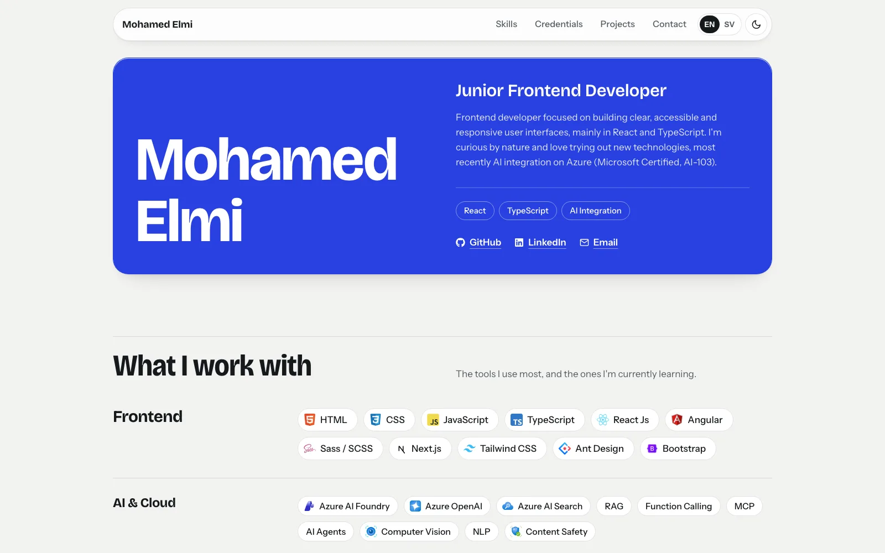

# Mohamed Elmi – Portfolio

**Live site: [elmi-portfolio.netlify.app](https://elmi-portfolio.netlify.app)**  
Svenska: [elmi-portfolio.netlify.app/?lang=sv](https://elmi-portfolio.netlify.app/?lang=sv)



My personal portfolio as a junior frontend developer. It shows my projects, skills and certifications, with light and dark mode, an English/Swedish switch and project filters (Frontend, Backend, AI development).

## Built with

- React 18 + Vite
- styled-components
- EmailJS (contact form)
- Hosted on Netlify

## Run locally

Requires Node.js 18 or newer.

```bash
git clone https://github.com/MohamedElmi10/MyPortfolio.git
cd MyPortfolio
npm install
npm run dev
```

Open the address Vite prints (usually http://localhost:5173).

| Command           | What it does                     |
| ----------------- | -------------------------------- |
| `npm run dev`     | Start the dev server             |
| `npm run build`   | Build for production to `dist/`  |
| `npm run preview` | Preview the production build     |
| `npm run lint`    | Run ESLint                       |

## Where things live

- `src/data/constants.js` – all content: bio, skills, certifications, projects
- `src/i18n/strings.js` – English and Swedish UI text
- `src/components/` – page sections (one folder per section)
- `src/styles/theme.js` – colors, spacing and fonts for light and dark mode

To add a project, add an entry to `projects` in `src/data/constants.js`.

## Contact

[GitHub](https://github.com/MohamedElmi10) · or use the contact form on the [live site](https://elmi-portfolio.netlify.app/#contact)
